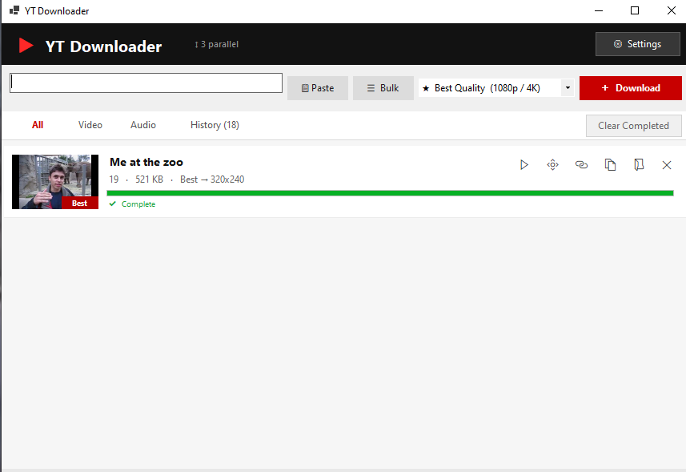

<div align="center">

# ▶ YT Downloader for Windows

**Free, open-source YouTube & Instagram video downloader for Windows.**
Download YouTube videos in 4K, 1080p or 720p, save YouTube as MP3 or M4A audio, and grab Instagram Reels, posts and stories — with a clean dark-mode desktop app, a download queue, bulk links and a searchable history.

[](https://github.com/johndoe2x/yt-downloader-windows/releases/latest)
[](LICENSE)


[Download](#-download--install) · [Features](#-features) · [How to use](#-how-to-use) · [FAQ](#-faq) · [Credits](#-credits)

</div>

---

<!-- Screenshot: save one as docs/screenshot.png and uncomment the line below. -->
<!--  -->

## Why this app?

Most "free YouTube downloaders" are full of ads, cap you at 360p, or quietly bundle extra software.
**YT Downloader** is a small native Windows app with **no ads, no tracking and no account**. It's a friendly
front end for [yt-dlp](https://github.com/yt-dlp/yt-dlp) — the most reliable video download engine there is —
plus [FFmpeg](https://ffmpeg.org/) to merge true high-quality video and audio streams.

## ✨ Features

### Download
- **YouTube video downloader up to 4K / 2160p60** — real best quality, not a 360p fallback
- **Quality picker:** Best (4K/1080p), 1080p Full HD, 720p HD, 480p, 360p
- **YouTube to MP3** and **YouTube to M4A** audio-only downloads
- **Video only** (no audio track) for editors
- **Instagram downloader** — Reels, posts, carousels (every clip), IGTV and stories
- Each finished row shows what you *actually* got: `3:32 · 68.4 MB · Best → 1920x1080`

### Speed & bulk
- **Parallel downloads** (1–10 at once, you choose)
- **Bulk download** — paste a whole block of text and every YouTube/Instagram link is picked out, de-duplicated and queued
- **Rate-limit safe pacing** — Gentle / Normal / Fast modes, automatic cooldown if YouTube or Instagram pushes back
- **Clipboard monitor** — copy a link anywhere and it lands in the app
- Live progress, speed and ETA on every item; one-click **Retry** on failures

### After the download
- **Drag finished videos straight into Telegram, WhatsApp, Discord or any folder**
- ▶ Play, open folder, copy file path, copy URL — one click each
- **History tab** that survives restarts: search, sort by date/size/name, thumbnails, "File missing" detection and one-click re-download
- Windows toast notification when a download finishes

### Comfort
- **Dark mode** and light mode
- **Auto-setup:** yt-dlp, FFmpeg and Deno are downloaded automatically on first launch — nothing to install by hand
- **Auto-update** of yt-dlp on startup, so YouTube changes don't break the app
- Works around YouTube's "Sign in to confirm you're not a bot" wall using your browser cookies or a `cookies.txt` file

## 📥 Download & install

1. Install the free **[.NET 10 Desktop Runtime](https://dotnet.microsoft.com/download/dotnet/10.0)** (x64) if you don't have it.
2. Download the latest **`YT-Downloader-win-x64.zip`** from the [Releases page](https://github.com/johndoe2x/yt-downloader-windows/releases/latest).
3. Unzip it anywhere and run **`YoutubeDownloaderVB.exe`**.

On first launch the app downloads yt-dlp, FFmpeg and Deno into its own folder (about 280 MB, one time only).

> Windows SmartScreen may warn about an unknown publisher because the app isn't code-signed.
> Click **More info → Run anyway**, or build it yourself from source (below).

## 🚀 How to use

1. Copy a YouTube or Instagram link.
2. Click **Paste** (or just press <kbd>Ctrl</kbd>+<kbd>V</kbd> — or turn on the clipboard monitor).
3. Pick a quality — e.g. **★ Best Quality**, **1080p**, or **MP3 Audio Only**.
4. Press **Download** (or <kbd>Enter</kbd>).

**Many links at once:** click **☰ Bulk**, paste anything containing links (a chat, a document, a list) and pick a pace.

Files are saved to your **Downloads** folder by default — change it in **⚙ Settings**.

## 🛠 Build from source

Requirements: Windows 10/11 and the [.NET 10 SDK](https://dotnet.microsoft.com/download/dotnet/10.0).

```bash
git clone https://github.com/johndoe2x/yt-downloader-windows.git
cd yt-downloader-windows
dotnet build -c Release
bin\Release\net10.0-windows\YoutubeDownloaderVB.exe
```

Written in **VB.NET + Windows Forms**, no NuGet packages.

| File | What it does |
|---|---|
| `Form1.vb` | Main window, download queue, yt-dlp / FFmpeg handling, auto-setup and updates |
| `Form1.Designer.vb` | Window layout |
| `BulkDownload.vb` | Bulk-links popup, pacing and rate-limit cooldown |
| `History.vb` | History tab (stored in `%APPDATA%\YTDownloaderVB\history.json`) |
| `SettingsDialog.vb` | Settings: save folder, parallel count, cookies, theme, notifications |

## ❓ FAQ

<details>
<summary><b>Is this YouTube downloader free?</b></summary>

Yes — free and open source under the MIT license. No ads, no premium tier, no sign-up.
</details>

<details>
<summary><b>Can it download 4K and 1080p YouTube videos?</b></summary>

Yes. "★ Best Quality" downloads the highest resolution YouTube offers (up to 2160p60) and merges video and audio with FFmpeg. Each row tells you the resolution you actually received.
</details>

<details>
<summary><b>How do I convert YouTube to MP3?</b></summary>

Choose **MP3 Audio Only** in the quality box before pressing Download. M4A is also available.
</details>

<details>
<summary><b>Can I download Instagram Reels and stories?</b></summary>

Yes. Paste any `instagram.com/reel/`, `/p/`, `/tv/` or `/stories/` link. Public posts work without logging in; private posts and stories need your Instagram cookies (see Settings).
</details>

<details>
<summary><b>I get "Sign in to confirm you're not a bot"</b></summary>

Open **⚙ Settings** and either pick a browser you're signed into YouTube with (Firefox works best), or export a `cookies.txt` with the *Get cookies.txt LOCALLY* browser extension and select it. The app gives yt-dlp a temporary copy so your export is never overwritten.
</details>

<details>
<summary><b>Does it work on Mac or Linux?</b></summary>

No — it's a native Windows app (Windows Forms). On other systems use [yt-dlp](https://github.com/yt-dlp/yt-dlp) directly.
</details>

<details>
<summary><b>Where are my settings stored?</b></summary>

`%APPDATA%\YTDownloaderVB\` — `settings.ini`, `history.json` and cached thumbnails. Deleting that folder resets the app; your downloaded videos are never touched.
</details>

## 🗺 Roadmap

- [ ] Playlist support
- [ ] Pause / resume
- [ ] Subtitle downloads
- [ ] Embed thumbnail in MP3
- [ ] System tray icon

Ideas and pull requests are welcome — open an [issue](https://github.com/johndoe2x/yt-downloader-windows/issues).

## 🙏 Credits

This app stands on the shoulders of these excellent open-source projects:

| Project | Role | License |
|---|---|---|
| [**yt-dlp**](https://github.com/yt-dlp/yt-dlp) | The download engine — extracts and downloads from YouTube, Instagram and more | [Unlicense](https://github.com/yt-dlp/yt-dlp/blob/master/LICENSE) |
| [**FFmpeg**](https://ffmpeg.org/) | Merges video + audio streams, converts to MP3/M4A, makes thumbnails | [LGPL 2.1+](https://ffmpeg.org/legal.html) |
| [**BtbN/FFmpeg-Builds**](https://github.com/BtbN/FFmpeg-Builds) | Ready-made Windows FFmpeg builds (LGPL variant) | — |
| [**Deno**](https://github.com/denoland/deno) | JavaScript runtime yt-dlp uses to solve YouTube's player challenges | [MIT](https://github.com/denoland/deno/blob/main/LICENSE.md) |
| [**.NET / Windows Forms**](https://github.com/dotnet/winforms) | App framework | MIT |
| **Segoe MDL2 Assets** | Row icons (ships with Windows) | Microsoft |

These tools are **not bundled** in this repository — the app downloads the official releases from their GitHub pages on first launch.
Huge thanks to the yt-dlp maintainers in particular; without their constant work no downloader would keep working.

Built by [**@johndoe2x**](https://github.com/johndoe2x).

## ⚖️ Disclaimer

This project is not affiliated with, endorsed by, or sponsored by YouTube, Google, Instagram or Meta. All trademarks belong to their owners.
Download only content you own, content in the public domain, or content you have permission to download, and respect each platform's Terms of Service and your local copyright law.

## 📄 License

[MIT](LICENSE) © 2026 johndoe2x

---

<sub>Keywords: youtube downloader, youtube video downloader for windows, download youtube videos 4k, youtube to mp3 converter, youtube to m4a, instagram reels downloader, instagram video downloader, bulk youtube downloader, yt-dlp gui, yt-dlp frontend windows, free open source video downloader, VB.NET WinForms</sub>
